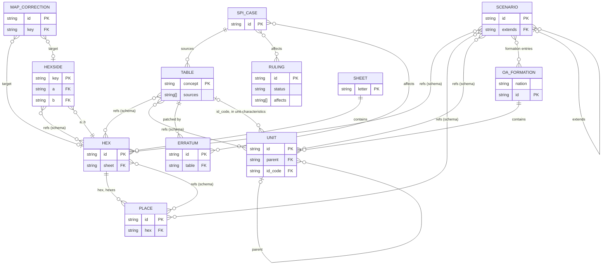
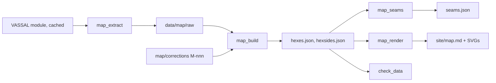
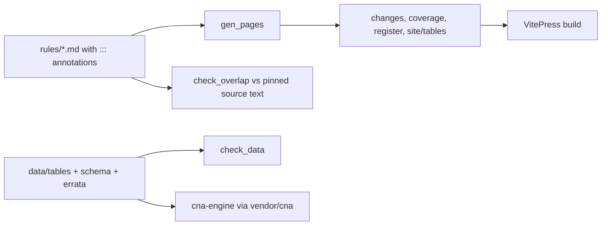

# Architecture

CNA Living Rules is the rulebook half of an open-source digital *Campaign for North
Africa*: SPI's rules restated in our own words, every chart, map hex, OA sheet and
scenario as validated JSON, and every ambiguity decided as a numbered ruling. It serves
rules readers (the VitePress site) and `basmith7/cna-engine`, which consumes `data/` as a
git submodule. It deliberately holds no engine code and no SPI text, map art or counter art.

Verified against 7f2e5c4 on 2026-10-29.

Setup, licences and the legal posture live in `README.md`; conventions and the
identifier grammar in `data/README.md`; unattended-run orders in `AUTOPILOT.md`.

## Codemap

- `rules/`: restated rules, one file per game system; `logistics/`, `air/` and
  `scenarios/` are optional modules. SPI case coverage is tracked by `::: spi-ref` /
  `::: spi-omit` lines in the prose. `rules/changes.md` and `rules/coverage.md` are
  **generated** (`tools/gen_pages.py`).
- `rulings/`: `R-nnn.md` (decided gaps) and `V-nnn.md` (variants), plus `README.md`
  (format and lifecycle). `rulings/register.md` is **generated**.
- `data/`: all game data (CC0), see the data model. Entry: `data/README.md`.
  `data/map/hexes.json`, `hexsides.json` and `seams.json` are **generated**;
  `data/spi-cases.json` is generated by `tools/gen_spi_cases.py` and then labelled by hand.
- `data/schema/`: JSON Schema 2020-12, one per table plus `common.schema.json` (shared
  `$defs`, enums, id patterns). The source of truth for shapes.
- `tools/`: Python CLIs, listed under Interfaces. Gate: `tools/check_data.py`.
- `tests/`: pytest, one file per tool or table; `tests/golden/` holds fixtures.
- `site/`: VitePress (`site/.vitepress/config.mts`, Node tests `*.test.mjs`).
  `site/tables/` and `site/map.md` and `site/learn.md` are **generated**.
- `docs/`: `designs/` and `plans/` (one pair per mission), `autopilot/` (`PROGRESS.md`
  for Brian, `JOURNAL.md` for the next run, `decisions.json` for open questions).
- `EXTRACTION.md` (per-file log of which cases were read), `ATTRIBUTION.md` (third-party
  text), `specs/site-polish/` (the only spec).
- `.github/workflows/ci.yml`: `check` (ruff and pytest, the shared `basmith7/workflows` python-ci),
  `gates` (`fetch.py`, `check_data`, `map_build --check`,
  `map_render --check`, `gen_architecture --check`, `check_overlap`, coverage report) and
  `site` (node tests, site build, overlap on built HTML). `deploy.yml` publishes the site.

## Data model

Source of truth: `data/schema/*.schema.json`, validated by `tools/check_data.py`. Ids are
strings with the grammar in `data/README.md` (`unit:cw:1-rnf`, `C4023`, `C4023|C4024`,
`R-012`, ...). Every record carries `sources` (`CNA1979:<case>`, `scan:p<n>`,
`vassal:<module>`). Tables are keyed by concept, not by SPI chart. Errata and map
corrections are RFC 6902 overlays on base data, never edits of it.

<!-- generated:erd -->

<!-- /generated:erd -->

Not in the diagram: a `TABLE` is any `data/tables/<concept>.json` (`table: <concept>`,
`rows`, `sources`) validated by `<concept>.schema.json`.

<!-- generated:tables -->
75 concepts: `air-bombardment`, `air-missions`, `air-reconnaissance`, `air-reinforcement-schedule`, `aircraft-characteristics`, `aircraft-refit`, `ammunition-consumption`, `anti-aircraft-results`, `anti-armour-results`, `assault-size-shifts`, `axis-air-reinforcement-schedule`, `axis-coastal-ships`, `axis-convoy-bombing`, `axis-convoy-capacity`, `axis-convoy-level`, `axis-malta-availability`, `axis-malta-commitment`, `axis-replacement-pool`, `barrage-results`, `breakdown`, `breakdown-adjustments`, `calendar`, `chariot-raid`, `close-assault-results`, `construction`, `convoy-lanes`, `convoy-reconnaissance`, `cp-costs`, `cw-fleet-schedule`, `cw-production`, `demolition`, `desert-raider-raids`, `destroyed-tank-repair`, `equivalent-weights`, `formation-organisation`, `foul-weather-location`, `fuel-evaporation`, `harbour-mining`, `initiative-ratings`, `logistics-sequence`, `malta-construction`, `maneuver-adjustment`, `max-attachments`, `morale-modifier`, `motorisation-losses`, `objective-loss`, `off-map-distances`, `patrol-reconnaissance`, `patrol-survival`, `pilot-arrival`, `pilot-plane-recovery`, `port-capacity`, `prisoners-captured`, `raid-on-rommel`, `reinforcement-schedule`, `replacement-conversion`, `replacement-training`, `sas-raid`, `scramble`, `seasons`, `simplified-supply`, `stacking-point-values`, `strafing`, `supply-dump-capacity`, `supply-dump-demolition`, `tacair-kill`, `terrain-effects`, `training`, `truck-characteristics`, `unit-characteristics`, `vehicle-repair`, `water-availability`, `weapon-systems`, `weather`, `well-poisoning`
<!-- /generated:tables -->

Scenarios place units by `unit:` id or by `formation` (`<nation>:<formation id>`), hexes by
id, `place` or `region`; a scenario may `extends` another and takes the blocks it omits.
`check_data.py` resolves all of these, and an OA unit's `replaces`/`assigns` references.

## Interfaces

**CLIs** (run with `.venv/bin/python tools/<name>.py`; gates exit non-zero on failure):

<!-- generated:tools -->
| Tool | Does |
|---|---|
| `tools/check_coverage.py` | Coverage report: which SPI cases have no primary badge in rules/. A report, not a gate — exits 1 only for malformed badges (unknown case, duplicate primary). |
| `tools/check_data.py` | Data gate: schemas valid, every table/errata file validates, every case reference exists. |
| `tools/check_overlap.py` | Overlap gate: fail if any N-word run (default 8) in our prose also occurs in the source transcription. A control against verbatim copying only. |
| `tools/decisions_page.py` | Build the decision board: one local page with every question waiting on Brian. |
| `tools/fetch.py` | Fetch pinned sources into ~/.cache/cna-scans. Nothing fetched here is ever committed. |
| `tools/gen_architecture.py` | Regenerate the machine-derived blocks of ARCHITECTURE.md: the data-model ERD, the table-concept list and the tools list. Each lives between `<!-- generated:<name> -->` and `<!-- /generated:<name> -->` markers. |
| `tools/gen_pages.py` | Generate the derived pages: rules/changes.md (every errata and ruling annotation, by file, plus the rulings register), rules/coverage.md (SPI case coverage by section) and rulings/register.md (browsable list of every ruling and variant), and the table pages (site/tables/, via tools/tables_page.py). |
| `tools/gen_spi_cases.py` | Generate data/spi-cases.json — the canonical list of SPI case IDs — from the anchors in the pinned source-text repo. Only IDs and structure are taken; no text. Two-digit cases ending in 0 are skipped as transcription defects (e.g., [#30_60] labeling [30.59]). |
| `tools/learn_page.py` | Build docs/learn/index.html — an illustrated introduction to CNA. |
| `tools/learn_tables.py` | Render data/tables/*.json combat tables as HTML for the site's Learn page (mission Part D). |
| `tools/map_build.py` | Build data/map/hexes.json and hexsides.json from raw/<sheet>.json + corrections/M-nnn.json. |
| `tools/map_diff.py` | Diff our map data against Norman Harman's private hex database (diff-only source). |
| `tools/map_extract.py` | Derive hex and hexside terrain from the CNA VASSAL module (v2.1.0). |
| `tools/map_geom.py` | Hex ID grammar, per-sheet adjacency and pointy-top pixel geometry for data/map/. |
| `tools/map_render.py` | Render data/map/ as one schematic SVG per sheet (ours: own palette, own symbols). |
| `tools/map_sample.py` | Seeded review sample for one map sheet: crops from the redraw and the scan plus a checklist. |
| `tools/map_seams.py` | Generate data/map/seams.json: the hexes that touch across each sheet edge. |
| `tools/tables_page.py` | Render every data/tables/<name>.json as a readable site page. |
<!-- /generated:tools -->

**Data files** (the contract with `cna-engine`):
- `data/tables/<concept>.json`, `data/oa/<nation>.json`, `data/scenarios/<slug>.json`,
  `data/map/{sheets,hexes,hexsides,places,regions,seams}.json`, `data/errata/E-nnn.json`.
- Rulings: `rulings/R-nnn.md` with YAML frontmatter (`id`, `status`, `affects`, `sources`);
  a few rulings are switches in the engine (`crates/cna-rules/src/ruleset.rs`, option
  numbers as in the ruling, defaulting to its Decision); the rest are listed in the
  engine's `NOT_SIMULATED.md`.

**What cna-engine consumes**: it vendors this repo at `vendor/cna` and its `cna-data`
crate (`crates/cna-data/src/*.rs`, one module per table family, plus `oa`, `scenario`,
`map`, `schedule`, `calendar`, `errata`) deserialises the JSON directly with serde. It never copies prose. So a
schema change is a breaking change for the engine: add fields, do not rename or remove,
and expect a request in cna-engine's `docs/autopilot/PROGRESS.md` (**Requests for cna**)
when a shape is wrong. Rulings cite the engine's `probes/<id>.json` measurements in their Rationale; the
decision board (`tools/decisions_page.py`) lists the rulings still waiting on Brian.

## Features

**Restated rules.** `rules/*.md` cover SPI sections 1-65 in our wording, annotated
`::: errata E-nnn`, `::: ruling R-nnn`, `::: variant V-nnn`. `gen_pages.py` collects the
annotations into `rules/changes.md`; `check_coverage.py` reports uncovered cases.

**Rulings.** A gap or contradiction becomes `R-nnn.md` (problem, options, decision,
rationale). Proposed rulings are decided by the procedure in `AUTOPILOT.md`; the prose
then shows the result.

**Map.** `map_extract.py` reads hexes from the cached VASSAL module into `data/map/raw/`;
hand fixes are `corrections/M-nnn.json` citing the scan; `map_build.py` merges them into
`hexes.json`/`hexsides.json`; `map_seams.py` joins sheet edges; `map_render.py` draws SVGs
for `site/map.md`. Design: `docs/designs/2026-09-21-map-design.md`.

**Scenarios and OA sheets.** Set-ups, per-nation organisation and the reinforcement
schedule as data an engine can load whole. Design:
`docs/designs/2026-10-08-scenarios-and-oa-design.md`.

**Site.** `npm run site:build` renders rules and data; table pages and the Learn page
are generated first. Optional "show original" fetches community text in the reader's
browser only.

**Autopilot.** Cron launches fresh sessions that work a mission queue and engine
requests; continuity is `docs/autopilot/PROGRESS.md` and `JOURNAL.md`.

## Flows

## Invariants and gotchas

- No SPI text, art or scan is committed or published. `check_overlap.py` fails any 8-word
  run shared with the source transcription; it needs `fetch.py sections` run first.
- Base tables hold values as printed in 1979; corrections are `data/errata/E-nnn.json`
  overlays, and prose describes the post-errata value.
- Generated files are never hand-edited: re-run the tool (`map_build`, `map_seams`,
  `gen_pages`, `gen_spi_cases`, `gen_architecture`). Raw map data changes only by
  extractor PR; hand fixes are `M-nnn` corrections whose `before` must match raw.
- Ids are sequential, ours and never reused (`E-`, `R-`, `V-`, `M-`); ruling numbers
  have gaps by design (logistics blocks of ten).
- Sheet-edge hexsides: both records of a pair must agree on `up`. Map A's numbering is
  staggered; always use `tools/map_geom.py` for adjacency and distance (`is_adjacent`,
  `distance`, which counts across sheet seams).
- A new enum value needs a data PR naming the case that introduces it; shared enums live
  only in `common.schema.json`.
- A PR is green only with: pytest, `check_data`, `check_overlap` (with and without a
  path), `gen_pages` leaving no diff, `npm run test:site`, `npm run site:build`.
- Never commit `build/`, `.venv/`, `~/.cache` contents, or `tools/sources.private.json`.
  Norman Harman's hex database is only a disagreement finder; nothing is copied or cited.
- No engine code lives here (AUTOPILOT.md): engine needs arrive as requests.

## Where to start

- **A rules wording fix**: the `rules/*.md` file for the system (`rules/changes.md` is
  generated); add an `EXTRACTION.md` entry; run `check_overlap.py`.
- **A table value**: `data/tables/<concept>.json` and its schema; errata go in
  `data/errata/E-nnn.json` plus a row in `data/errata/INDEX.md`.
- **A ruling**: `rulings/R-nnn.md` per `rulings/README.md`, then the `::: ruling` block in
  the rules file for each case in its `affects`, then `tools/gen_pages.py`.
- **A map hex or hexside**: add `data/map/corrections/M-nnn.json`, then `tools/map_build.py`
  and `tools/map_seams.py`; never edit `hexes.json`.
- **A scenario or OA unit**: `data/scenarios/<slug>.json` (shape: `scenario.schema.json`) or
  `data/oa/<nation>.json` (`oa.schema.json`);
  `tools/check_data.py` resolves unit, hex and place references.
